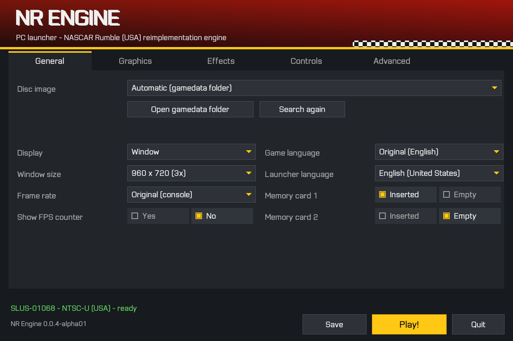
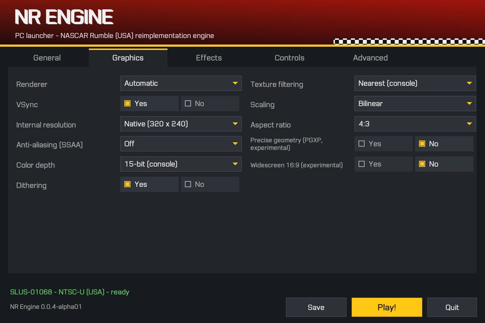
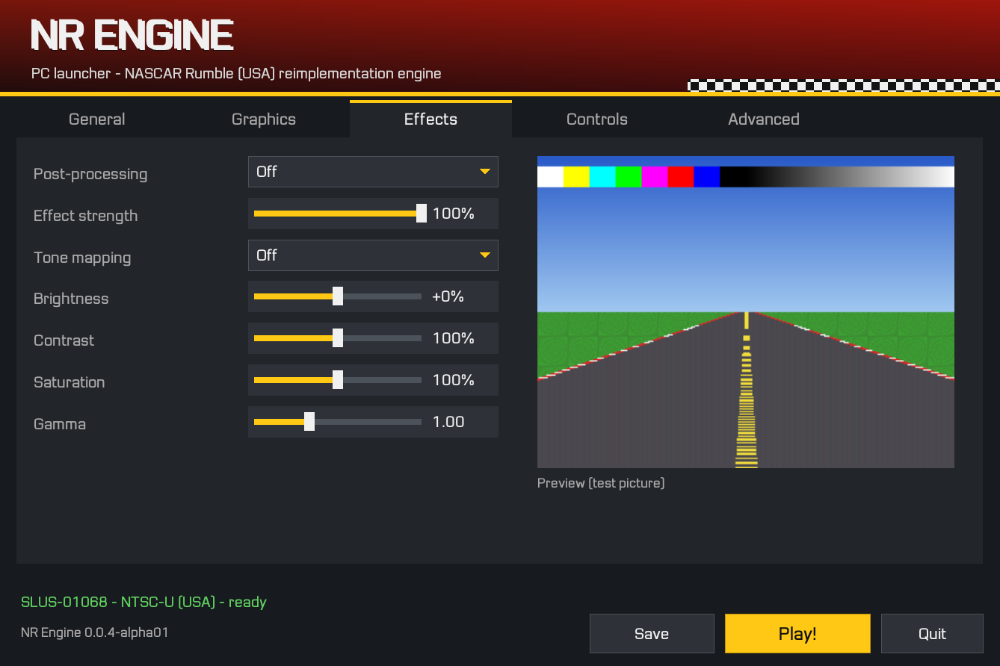
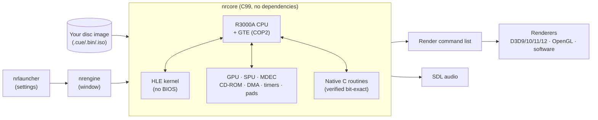

# NR Engine — NASCAR Rumble Reimplementation Engine

A from-scratch engine, written in portable C99, that runs **NASCAR Rumble**
(PlayStation, EA Sports, 2000 — North American release SLUS-01068) on
Windows and Linux from **your own copy of the game**, with optional picture
enhancements and a launcher for every setting.


> [!WARNING]
> **This is alpha software (0.0.4-alpha01).** It boots the game and plays a
> race, but it is still in development: expect bugs, missing validation and
> behaviour that differs from the console. Full compatibility with the
> original game is **not** claimed. Please read
> [Known issues](#known-issues) and [Reporting issues](#reporting-issues)
> before opening an issue.

> [!IMPORTANT]
> This repository contains **no game data**: no executable, no disc image, no
> textures, sounds, videos or text from the game, and no PlayStation BIOS. You
> need your own disc image of NASCAR Rumble (USA). See
> [docs/LEGAL.md](docs/LEGAL.md).

## Screenshots

The pictures show the project's own launcher. Captures of the game itself are
deliberately not included in the repository (see [Legal](#legal)).

| General | Graphics |
|---|---|
|  |  |

| Effects (live preview on the built-in test picture) |
|---|
|  |

## Platform status

| Platform | Status |
|---|---|
| Windows 10 (x86-64) | Built with MinGW-w64 GCC and SDL3. Boot to race verified on real hardware (Ryzen 7 5700X, RTX 3060). Direct3D 9, 10, 11 and 12, OpenGL and the software renderer all start. |
| Windows 11 (x86-64) | Expected to behave like Windows 10; not tested yet. |
| Windows 7 SP1 / 8 / 8.1 | Supported by the code (Windows 7 is the minimum API level). Not tested on real hardware. UCRT builds need update KB2999226; see [docs/BUILD.md](docs/BUILD.md#53-windows-7-to-windows-11). |
| Linux (x86-64) | Builds with GCC and Clang (SDL3 or SDL2), unit tests and sanitizers clean. Boot to race was verified with OpenGL (Mesa) in earlier development builds. |
| Debian 13 / Ubuntu 26.04 | `.deb` package built for both; not yet installed on a clean system. |
| macOS | Not supported. |

## What works

- Boot without a BIOS: the PlayStation kernel is reimplemented at high level.
- Legal screen, EA logos and intro video at the correct speed, with audio in sync.
- Title, menus, car and track selection, loading screens.
- 3D race with the AI cars, HUD, minimap, speedometer, music and sound effects.
- Memory card saving and loading (Game Options > Load and Save).
- Steady physics step: handling and collisions do not change when the frame rate drops.
- Keyboard and generic USB controllers, through the system driver or read directly over USB HID, with remapping.
- Pause and quit dialog on Esc, full screen on F11, screenshots on F12.

## Enhancements

All enhancements act only on the picture shown to the player. The console
VRAM that the game reads stays bit-identical to the original hardware
behaviour, which the test suite verifies.

| Feature | Details |
|---|---|
| Renderers | Direct3D 9/10/11/12 (Windows), OpenGL 3.3 (Windows and Linux), software |
| Internal resolution | 1× (320×240) up to 8× |
| Anti-aliasing | supersampling 2×, 4×, 8×, 16× |
| Colour | 24-bit shading and blending, optional dithering |
| Texture filtering | bilinear on 3D only or on everything |
| Post-processing | CRT, scanlines, vignette, colour grade, film grain, sharpen, cinematic |
| Tone curves | Reinhard, ACES, filmic: hue-preserving, applied to linear luminance |
| PGXP (experimental) | sub-pixel vertices and perspective-correct textures |
| Widescreen (experimental) | 16:9 projection |
| Frame rate | original, 20, 30 or 60 fps |
| Hardware limits | RAM, CPU threads and GPU memory are detected; the launcher only offers resolution and anti-aliasing combinations that fit |

Details in [docs/GRAPHICS.md](docs/GRAPHICS.md).

## How it works

The game's original code (the `SLUS_010.68` executable read from *your*
disc) runs on a core written from scratch, while game routines are
progressively replaced by native C code that is verified bit for bit against
the original.



- **CPU**: interpreted R3000A with delay slots, COP0 exceptions, and
  instruction-cache and memory timing calibrated against hardware
  measurements.
- **GTE**: bit-exact against 1 150 hardware test vectors.
- **GPU**: software rasteriser with a drawing-time model.
- **SPU**: 24 voices with reverb.
- **Other hardware**: MDEC, CD-ROM controller, DMA, timers and controller ports.
- **Kernel**: reimplemented at high level (HLE). No Sony BIOS is used or needed.
- **Native routines**: today the game's BS video decoder. Each one can be
  checked against the original with `--verify-natives`.

See [docs/ARCHITECTURE.md](docs/ARCHITECTURE.md) and [docs/NATIVE.md](docs/NATIVE.md).

## Play

### Windows

1. Build the engine (see [Build](#build)) or use a release package.
2. Put your disc image in the `gamedata\` folder next to `nrlauncher.exe`
   (any file name: `.cue` + `.bin`, `.bin` or `.iso`).
3. Start `nrlauncher.exe`, adjust the settings and press **Play!**

### Debian / Ubuntu

```sh
sudo apt install ./nrengine_0.0.4~alpha01_amd64.deb
nrlauncher
```

Copy your disc image to `~/.local/share/nrengine/gamedata/` or choose it with
**Browse...** in the launcher.

### Default keys

| Key | PlayStation |
|---|---|
| Arrow keys | D-pad |
| Z | ✕ (accelerate / confirm) |
| X | ◯ |
| A | ▢ |
| S | △ |
| Q / W / E / R | L1 / R1 / L2 / R2 |
| Enter | Start |
| Space | Select |
| Esc | pause and quit dialog |
| F11 | full screen |
| F12 | screenshot (saved locally, for personal use only) |

Controllers: [docs/CONTROLLERS.md](docs/CONTROLLERS.md).

## Build

Warnings are treated as errors on every compiler; a build that produces a
warning fails.

### Windows (MinGW-w64 + SDL3)

Requirements: CMake 3.16+, an x86-64 MinGW-w64 toolchain in `PATH`, and the
SDL3 development package for MinGW.

```bat
scripts\build_windows.bat C:\SDL3
```

The script configures, builds, runs the unit tests and reports which C
runtime the toolchain uses. The executables end up in `build-sdl3-mingw\`.

### Linux

```sh
sudo apt install build-essential cmake libsdl3-dev
scripts/build.sh
./build/nrlauncher
```

### Debian / Ubuntu package (.deb)

```sh
scripts/build_deb.sh                 # on Debian or Ubuntu
scripts\build_deb_docker.bat         # on Windows, with Docker Desktop running
```

The package targets Debian 13 and Ubuntu 26.04 and is written to `dist/`.
Full instructions, including Visual Studio and cross-compiling:
[docs/BUILD.md](docs/BUILD.md).

## Testing

| Command | What it checks |
|---|---|
| `ctest --test-dir <build dir>` | unit tests, SDL adapter, configuration, fonts, mods and renderer safety; no game data needed |
| `NR_DISC=<your .cue> <build dir>/nrtests` | adds the regression tests with your disc: boot and race VRAM checksums, native routines, memory card, enhanced rendering not affecting the console VRAM |
| `nrengine_headless --frames N --screenshot-at A,B` | headless run for diagnostics (output files contain game data: keep them local) |

Details in [docs/TESTS.md](docs/TESTS.md).

## Known issues

- Full races up to the results screen, the championship, 2-player mode and
  every track and car have not been walked through systematically.
- Generic USB controllers are covered by unit tests but have not been tested
  with physical controllers.
- Windows 7, Windows 8.x and Windows 11, MSVC builds and a clean Debian or
  Ubuntu install of the `.deb` are not tested yet.
- PGXP and widescreen are experimental. Widescreen changes what the game
  computes, and objects can pop in at the screen edges.
- The GPU renderers do not honour the console's mask bit. The software
  renderer does.
- Audio is checked by amplitude only. It has not been compared with a
  recording from real hardware.
- Tone curves (ACES, filmic) are look curves for a standard-range picture.
  They raise contrast by design; keep `tonemap = off` for the console's look.

The complete list is in [docs/STATUS.md](docs/STATUS.md).

## Reporting issues

Every issue is about an **alpha** build. Please include:

- the version shown at the bottom of the launcher (for example `0.0.4-alpha01`);
- your operating system, CPU, GPU and the renderer selected;
- `nrengine.log` from the settings folder (launcher, Advanced tab, **Open settings folder**);
- the steps to reproduce the problem.

Do **not** attach disc images, files from the disc, memory cards, save states,
RAM or VRAM dumps, or screenshots of the game to public issues.

## Versioning

The current version is **0.0.4-alpha01**. Builds numbered 0.1.0 to 0.3.2 were
internal development builds. The numbering restarted at 0.0.4-alpha01 so that
the project's stage is clear to everyone. The Debian package uses the epoch
`1:`, so `1:0.0.4~alpha01` replaces an installed 0.3.x package.

## Documentation

| Document | Contents |
|---|---|
| [docs/BUILD.md](docs/BUILD.md) | dependencies; building on Linux and Windows; Windows 7–11 notes; `.deb` package |
| [docs/CONFIG.md](docs/CONFIG.md) | launcher, disc selection, file locations, `nrengine.ini`, command line |
| [docs/GRAPHICS.md](docs/GRAPHICS.md) | renderers, resolution, anti-aliasing, filters, effects, tone curves, memory limits, frame rate |
| [docs/CONTROLLERS.md](docs/CONTROLLERS.md) | keyboard, system-driver and direct-USB controllers, remapping, Linux udev rule |
| [docs/MODS.md](docs/MODS.md) | `mods/` folder, language packs, file replacement |
| [docs/ARCHITECTURE.md](docs/ARCHITECTURE.md) | modules, core and platform layers, execution flow |
| [docs/NATIVE.md](docs/NATIVE.md) | replacing original functions with C and how they are verified |
| [docs/FORMATS.md](docs/FORMATS.md) | game file formats documented so far |
| [docs/CODE.md](docs/CODE.md) | reference of public functions and types |
| [docs/STATUS.md](docs/STATUS.md) | what is implemented and validated, differences, pending work |
| [docs/TESTS.md](docs/TESTS.md) | automated tests and diagnostics |
| [docs/LEGAL.md](docs/LEGAL.md) | what is never distributed and why |
| [THIRD_PARTY_NOTICES.md](THIRD_PARTY_NOTICES.md) | third-party code and references |

## Programs

- `nrlauncher` — the launcher (settings, disc selection, starts the game).
- `nrengine` — the engine window (started by the launcher).
- `nrengine_headless` — the same engine without a window, for tests and diagnostics.
- `nrtool` — inspection of your own image (identification, file CRCs, listing, disassembly, translation template). Files it writes contain game data and must not be redistributed.
- `nrtests` — unit tests, plus regression tests with your disc.

## Legal

NR Engine is an unofficial fan project. It is not affiliated with, sponsored
by or endorsed by Electronic Arts, NASCAR or Sony Interactive Entertainment.
NASCAR, NASCAR Rumble, EA SPORTS and PlayStation are trademarks of their
respective owners.

The repository holds only code, scripts, documentation and artwork written
for this project. It also holds non-expressive metadata used to identify the
disc: file names, sizes, CRC32 and SHA-1 values, routine addresses and VRAM
checksums. None of these can rebuild any game content. The user supplies
their own legal copy of the game; the engine reads it at run time and never
modifies or copies its files. See [docs/LEGAL.md](docs/LEGAL.md).

## License

The project's own code, the NREngine Sans launcher font and the project icons
are released under the [MIT licence](LICENSE). Third-party components are
listed in [THIRD_PARTY_NOTICES.md](THIRD_PARTY_NOTICES.md).

## Credits

- **psx-spx** (Martin Korth / nocash and contributors): PlayStation hardware documentation.
- **ps1-tests** by Jakub Czekański: hardware test vectors.
- **OpenBIOS** from PCSX-Redux: reference for the memory-card event sequence.
- **SDL**: windowing, input and audio.
- **stb_truetype** by Sean Barrett: launcher text rendering.

Projects such as REDRIVER2, the Silent Hill PC port and PS2Recomp were
consulted as references for how reimplementation projects
are organised. No code from them was used.
